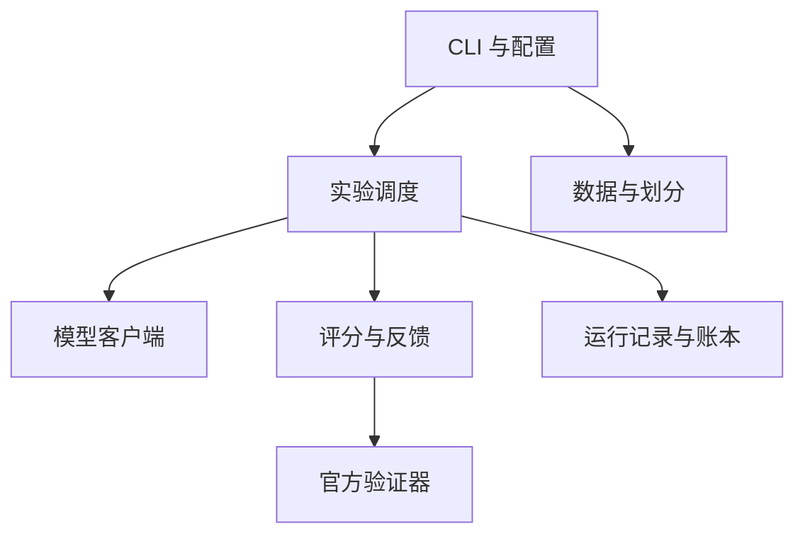

# IFBench 反馈实验项目结构设计与迁移计划

状态：轻量整理（阶段 0–2）已做；阶段 3 起的代码拆分**明确未做**（不拆 `cli.py` / `store.py`）。正式生成与量化分析已完成；盲审标签和报告未完成。研究规则见 [实验协议](EXPERIMENT_PROTOCOL.md)；日常命令见 [运行手册](feedback_eval.md)；阶段验收见 [执行计划](EXPERIMENT_EXECUTION_PLAN.md)。既有 `docs/superpowers/plans/2026-11-12-ifbench-feedback.md` 仍是任务拆分依据。

## 目标

使官方 IFBench、项目新增的反馈实验、配置、结果及文档的职责清楚，并保留官方评分口径、实验可复现性与已有记录。结构调整本身不改变研究问题、实验条件、样本或模型。正式试验的运行与分析进度见执行计划，不以本文替代。

## 当前结构与事实

| 位置 | 目前用途 | 结构问题或依赖 |
| --- | --- | --- |
| `ifbench/` | 上游验证器和打包数据 | 实验的 `feedback_eval/feedback.py` 直接导入 registry；NLTK 资源需要可访问路径 |
| `evaluation_lib.py`, `run_eval.py`, `generate_responses.py`, `config.py` | 上游评分、运行与配置 | `feedback_eval/scoring.py` 直接导入根目录的 `evaluation_lib`，不能单独移动 |
| `data/IFBench_test.jsonl`, `ifbench/data/IFBench_test.jsonl` | 上游两份数据 | 两份各 300 条，但 ID 13 和 19 的提示词末尾空格不同；实验固定使用前者的原始字节及哈希 |
| `feedback_eval/` | 项目新增实验代码 | `cli.py` 含冻结、运行、`analyze` / `review-pack`；`analysis.py` 做配对表与盲审包；`store.py` 仍兼记录与预算 |
| `configs/feedback_eval/` | 划分、提示词、开发/正式/敏感性配置 | `official.yaml`、`split.json`、`homology.json` 已纳入版本控制 |
| `tests/feedback_eval/` | 离线测试 | `conftest.py` 隔离 `.env` 并拒绝测试套件打开 HTTP；2026-11-13 为 124 passed |
| `runs/feedback_eval/` | 正式结果、敏感性重跑、开发探测和账本 | Git 忽略；含 2080 条 4096 记录；不得删除或覆盖冻结 `records/` |
| `docs/EXPERIMENT_PROTOCOL.md`, `docs/EXPERIMENT_EXECUTION_PLAN.md`, `docs/feedback_eval.md`, `docs/superpowers/` | 协议、计划与运行记录 | 内容跨多个入口，部分状态和命令可能随代码变化而过时 |
| `.coverage`, `__pycache__/`, `eval/` | 上游仓库已跟踪的缓存和示例评分 | 不能仅依靠 `.gitignore` 清除已跟踪文件；`eval/` 可能是上游示例，应先确认再调整 |

上游基线提交 `cd189a9c2889526d8af901d2103fd3e1ffcea6df` 已包含上述 `.coverage`、字节码、两份数据和 `eval` 示例。当前 `origin` 为课程仓库 `https://github.com/krabbypatty1031-blip/IFBench-feedback-eval.git`；`upstream` 为 AllenAI 只读。工作分支 `comp4136-feedback-eval`。未经用户要求不要提交或推送。

## 建议的目标结构

下图为目标职责，不要求本次立即移动上游文件：

```text
IFBench/
├── README.md                    上游说明保留；新增指向项目入口的简短链接
├── ifbench/                     官方验证器与打包数据
├── evaluation_lib.py            官方评分兼容入口（暂保留）
├── run_eval.py                  官方评分命令（暂保留）
├── generate_responses.py        官方生成命令（暂保留）
├── data/                        官方输入与示例；保留实验使用的原始数据
├── feedback_eval/               本项目实验实现
├── configs/feedback_eval/       可版本控制的实验配置、提示、划分与审计
├── tests/feedback_eval/         本项目的离线单测与集成测试
├── docs/
│   ├── feedback_eval.md              运行入口与复现命令
│   ├── feedback_eval_review.md       盲审协议
│   ├── EXPERIMENT_PROTOCOL.md        研究协议与评分定义
│   ├── EXPERIMENT_EXECUTION_PLAN.md  阶段交付与验收
│   ├── ARCHITECTURE_PLAN.md          本设计与迁移记录
│   └── superpowers/plans/            阶段任务计划
└── runs/feedback_eval/               本地运行证据与账本；不纳入 Git
```

`.env`、`.venv`、NLTK 资源及缓存为本地环境；配置示例不包含密钥。当前项目没有必要复制一整份上游代码到 `vendor/`：现有项目就是上游仓库的分支，先通过边界与文档区分来源，可避免 import 和评分路径的大范围变化。后续若需要更深隔离，应另行设计、先复制验证再迁移。

## 依赖关系



研究协议决定实验规则；官方 `evaluation_lib`、`ifbench` 决定已有评分行为；新增实现负责调用、反馈、续跑和记录。运行记录与账本是实验凭据，不应与可再生缓存混为一类。

## 推荐的代码边界

1. `dataset.py` 负责原始数据加载、哈希和分组划分；禁止悄悄清洗或修改原题。
2. `scoring.py` 负责调用官方 strict/loose；`feedback.py` 将可验证的评分状态转换为反馈，不能编造验证器原因。
3. `runner.py` 负责单题 B0–B3 的消息和依赖；`execution.py` 负责跨模型和题目的调度、续跑与状态汇总。
4. `client.py` 负责 API 输入输出和错误；记录中屏蔽密钥。`store.py` 负责可靠保存、恢复和一致性检查。
5. 可在后续按实际需要将 `store.py` 的冻结、账本及配置解析拆到独立模块；必须先明确接口并维持兼容，不在纯整理任务中顺带改变预算策略。
6. `cli.py` 作为薄入口，参数解析与应用流程逐步分离；命令和默认路径变更须保留兼容或提供迁移说明。

这些是目标边界，并非已经完成。当前正式执行入口、预算字段和测试可能正在变化，需要结合实际代码验收，不应以本文件替代代码事实。

## 分阶段实施计划

### 阶段 0：固定现状与保护资料

- 记录分支、HEAD、`git status`、已跟踪及未跟踪文件；检查是否有运行中的模型实验。保留全部用户未提交改动，不重置或覆盖。
- 对数据、划分、提示、配置、NLTK 资源、冻结记录、试跑结果和账本建立清单及 SHA-256；不读取或打印 API 密钥。校验备份后才允许移动。
- 确认哪些材料是上游示例、历史开发结果或正式结果。`.env`、`.venv` 和 `runs` 保持本地，不进入 Git。
- 验收：清单能定位每个保护对象；基线测试通过或既有失败被记录。不得在运行过程中移动活动目录。

### 阶段 1：先改善入口与文档

- 新增项目导航：说明官方代码与新增代码、安装方式、NLTK 路径、离线验证命令、开发与正式运行边界。
- 以实验协议为研究规则来源，以运行手册为当前操作来源；历史试跑保留时间和目录，避免混入当前配置。
- 对三个计划文档建立明确链接和状态说明，不改写已发生的事实或将试跑当作正式结果。
- 验收：从 README 能找到协议、计划、运行方式和架构；所有本地链接存在；官方示例命令和现有测试不受影响。

### 阶段 2：整理可追踪与本地产物

- 核查 `.gitignore` 与 `git ls-files`；区别新产生的缓存和上游已跟踪文件。计划移除跟踪中的字节码或 `.coverage` 前，记录上游来源、当前修改与重建方法；在独立、可审查的变更中处理，保留历史。
- `eval/` 的现有文件先确认是官方示例；默认不删除，不与新增实验结果共用输出目录。历史运行文件按原路径保留；如必须移动，使用逐文件清单、字节及哈希校验，并保留旧路径映射与必要兼容。
- `.env` 不应被读取到测试或纳入版本控制。检查现有测试的网络隔离及示例文件，不打印敏感内容。
- 验收：`git status` 只显示预期修改；原始数据和历史记录哈希不变；忽略规则不会隐藏需要版本管理的配置与测试。

### 阶段 3：按责任小步拆分代码（未做）

- 对 `store.py` 和 `cli.py` 先做依赖与调用图、补充关键行为测试，再逐项抽取；先保留原公开 import、CLI 参数及输出格式的兼容层。
- 每次只迁移一项职责，例如先抽取配置读取或报告汇总；确保模型名称、ID、评分输出、失败状态和预算行为没有变化。明确引用关系后再考虑重命名。
- 验收：每一步运行相关离线测试与官方测试，比较固定 fixture 的 strict/loose、反馈、运行身份和账本结果；出现不一致立即定位，不覆盖历史结果。

### 阶段 4：验证冻结与续跑兼容

- `collect_source_hashes` 当前按 `feedback_eval/*.py` 的文件名与内容计算代码哈希，同时绑定数据、划分、提示及支持清单。移动、拆分或重命名代码会改变指纹；冻结还记录 Git HEAD。整理后必须建立新冻结及新运行目录。
- 旧冻结、旧记录和费用证据保留原样。禁止篡改旧 `freeze.json` 使其看似匹配新代码；旧运行的恢复能力需要在原代码快照和临时副本上测试，新版本结果单独标识。
- 验收：旧文件字节和哈希不变；修改数据或提示后新运行正确拒绝混用；离线演练验证中断、恢复、幂等及记录对账。

### 阶段 5：最终核验

- 核验 `NLTK_DATA="$PWD/ifbench/.nltk_data" PYTHONDONTWRITEBYTECODE=1 .venv/bin/python -m pytest instructions_test.py -q` 和 `NLTK_DATA="$PWD/ifbench/.nltk_data" PYTHONDONTWRITEBYTECODE=1 .venv/bin/python -m pytest tests/feedback_eval -q`；如环境不同，记录实际结果而非沿用旧数量。
- 在临时目录运行官方评分样例、双模型模拟及续跑，核对 strict/loose、缺失和调用次数。检查文档相对链接、`git diff --check`、数据与保护清单哈希。
- 验收：文件分类清楚、没有意外删除或改动，真实调用记录可查，所有不兼容点有迁移说明。此阶段无需付费调用。

## 执行顺序与当前不确定项

本次轻量整理只做阶段 0–2（文档入口、目录约定、忽略规则）。阶段 3–5 的代码拆分、冻结重做和最终核验另行决定。正式配置中的模型、费用上限、单价和余额属于实验运行状态；本文不验证其真实性或重新设定预算。

截至 2026-11-13：正式 generate 已结束，量化表与盲审包已写出，没有正在运行的模型任务。未移动官方评分路径。旧冻结 `a333e677…` 不得改哈希；之后改 `feedback_eval/*.py` 只影响未来新冻结。阶段 3 未做：`cli.py` 与 `store.py` 仍承担多职责。`analysis.py` 已加入，不回溯改 4096 `records/`。
